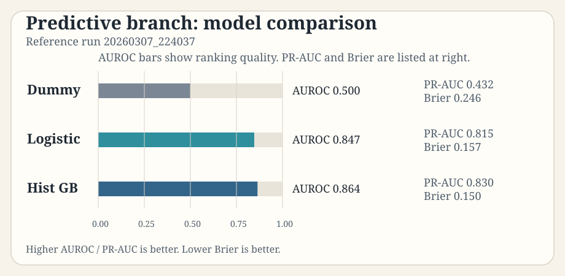
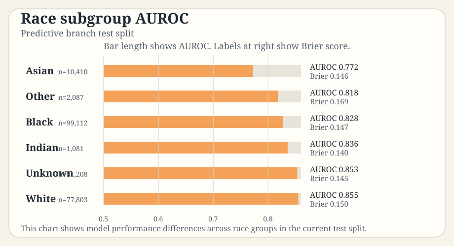
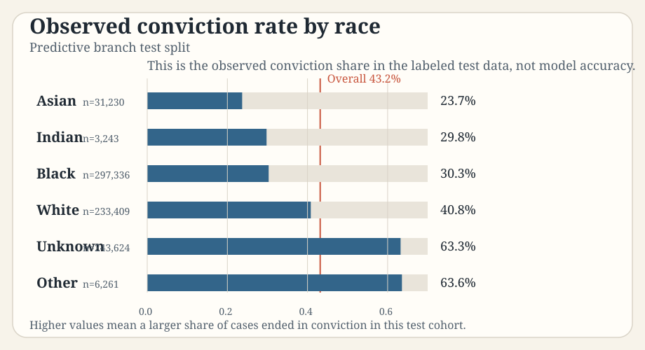
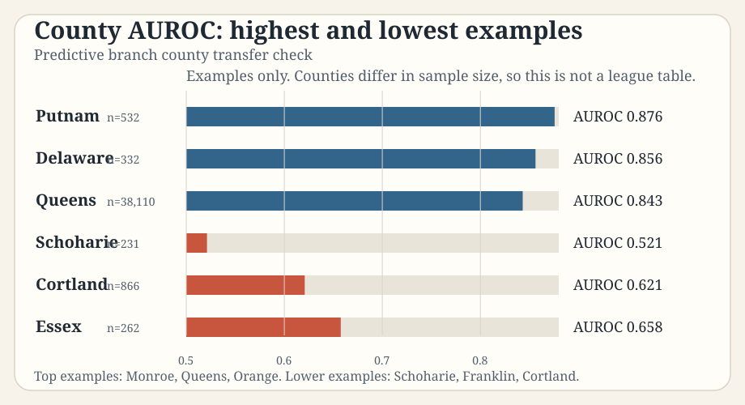
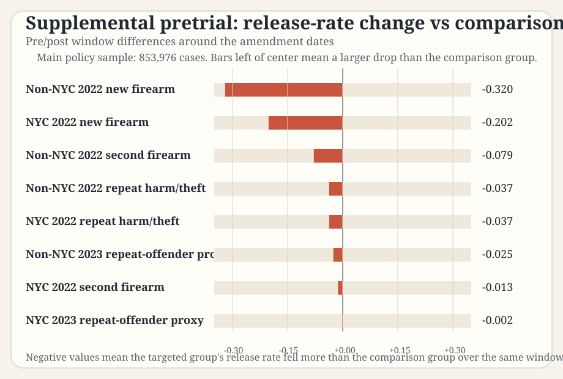
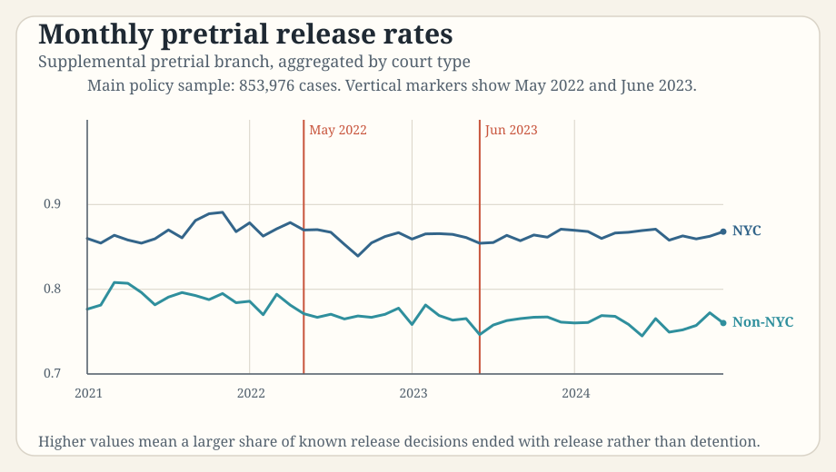
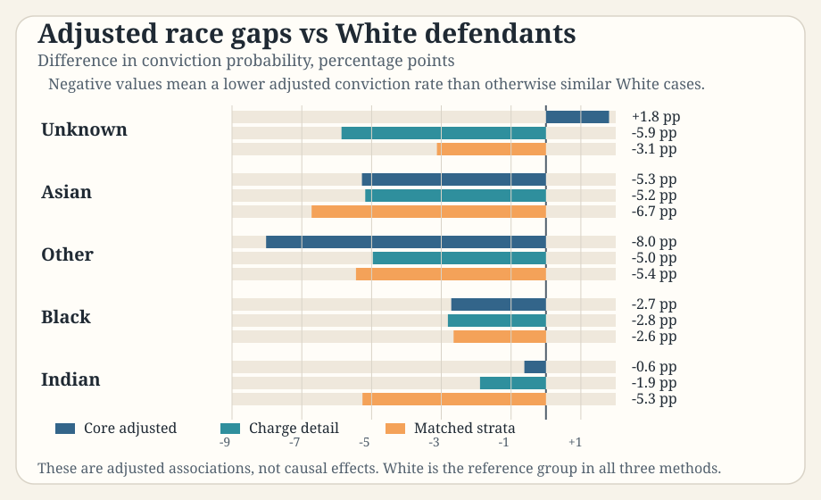

# juryrig

**[Browse the interactive results site](https://smkwray.github.io/juryrig/)**

An analysis of New York public court records. Using ~1.6 million OCA-STAT arraignment records and ~854,000 supplemental pretrial cases, this project examines conviction patterns and pretrial release-rate shifts around bail-law amendments. The best predictive model reaches **0.86 AUROC** and **78% accuracy** on a held-out test set of 271,701 cases without using protected attributes (Gender, Ethnicity, Race) as training features. The clearest pretrial finding: firearm charges newly eligible for detention after May 2022 saw release-rate drops of **20–32 percentage points** relative to comparison cases. Geography is the single strongest split — NYC courts show a 23.4% conviction rate vs. 69.3% outside NYC.

## Start here

| If you want... | Go to |
|---|---|
| **Interactive results site** | [`docs/index.html`](docs/index.html) — browsable charts, findings, methodology |
| Public overview | [`docs/public-brief.md`](docs/public-brief.md) |
| Race-adjusted association explainer | [`docs/race-adjusted-association.md`](docs/race-adjusted-association.md) |
| Reader FAQ | [`docs/reader-faq.md`](docs/reader-faq.md) |
| Data sources and provenance | [`docs/data.md`](docs/data.md) |

### Models used

- **LogisticRegression** — best model (AUROC 0.8643); solver=saga, max_iter=2000
- **HistGradientBoostingClassifier** — gradient boosting baseline (AUROC 0.8639), sigmoid-calibrated (3-fold CV)
- **DummyClassifier** — majority-class floor baseline (strategy=prior)

Full methodology: [`docs/METHODS.md`](docs/METHODS.md).

### Visual quick look

Figures are generated from aggregate outputs. No row-level data is committed to the repo.

<table>
  <tr>
    <td></td>
    <td></td>
  </tr>
  <tr>
    <td></td>
    <td></td>
  </tr>
  <tr>
    <td></td>
    <td></td>
  </tr>
  <tr>
    <td colspan="2" align="center"></td>
  </tr>
</table>

**Top row:** Model comparison across three baselines (left) and AUROC broken out by race subgroup (right). The gradient-boosting model substantially outperforms the dummy baseline; ranking quality varies across race groups.

**Middle row:** Observed conviction rates by race in the test cohort (left) and county-level AUROC at the high and low ends (right). Geography drives the widest variation in both outcomes and model performance.

**Third row:** Pretrial release-rate changes around amendment dates relative to comparison cases (left) and the monthly release-rate trend by court type (right). The May 2022 firearm category shows the sharpest shift.

**Bottom:** Adjusted conviction-rate differences by race relative to White defendants, across three estimation approaches. See the [race-adjusted association explainer](docs/race-adjusted-association.md) for methodology and caveats.

---

## Key Findings

### Predictive branch

**Question:** How well can a model estimate whether a New York criminal case will end in conviction, using only arraignment-time information?

**Data:** `1,609,252` modeled rows from OCA-STAT (2021–2025 cohorts). Test split: `271,701` cases. Reference run `20260320_231413`.

**Method:** Binary classification. Three models compared: a dummy baseline, logistic regression, and histogram-based gradient boosting. Features include county, charge severity, and arrest type. Protected attributes (Gender, Ethnicity, Race) are excluded from training by default but retained for subgroup auditing. An `include_all` comparison showed no meaningful performance difference (AUROC 0.8643 vs 0.8653).

#### Model performance

| Model | Accuracy | AUROC | PR-AUC | Brier |
|---|---:|---:|---:|---:|
| dummy | 0.5684 | 0.5000 | 0.4316 | 0.2461 |
| **logistic_regression** | **0.7818** | **0.8643** | **0.8364** | **0.1474** |
| hist_gradient_boosting | 0.7847 | 0.8639 | 0.8314 | 0.1499 |

**Metric quick defs:** **Accuracy** = share of cases classified correctly. **AUROC** = how well the model ranks cases from lower to higher likelihood (higher is better). **PR-AUC** = ranking quality weighted toward the positive class. **Brier** = probability calibration error (lower is better).

The best model (`logistic_regression`, selected on validation Brier score) correctly classifies about 78% of cases and ranks cases well (AUROC 0.86). It substantially outperforms a dummy baseline that assigns every case the same average probability. Gradient boosting performs comparably (AUROC 0.86), with the simpler logistic model slightly edging it on calibration.

#### Strongest observed splits

These are raw observed differences in the data, not adjusted for other variables.

| Split | Group | Conviction rate |
|---|---|---:|
| Region | NYC | 23.4% |
| Region | Non-NYC | 69.3% |
| Charge severity | Violations | 25.2% |
| Charge severity | Felonies | 65.8% |

Geography is the largest descriptive split in this dataset. Cases inside NYC have a conviction rate roughly 46 percentage points lower than cases outside NYC. Charge severity is the next strongest pattern — felonies are convicted at roughly 2.6 times the rate of violations.

#### Race subgroup results

Model performance is not uniform across race groups. Observed conviction rates and model ranking quality both vary.

| Race group | Observed conviction rate | AUROC | Brier |
|---|---:|---:|---:|
| Asian | 23.7% | 0.7722 | 0.1457 |
| Black | 30.3% | 0.8276 | 0.1465 |
| White | 40.8% | 0.8550 | 0.1503 |
| Unknown | 63.3% | 0.8531 | 0.1454 |

The model ranks some race groups more accurately than others. AUROC ranges from 0.77 (Asian) to 0.86 (White) — a 0.08-point gap. Brier scores are consistent across groups (0.145–0.150), indicating that probability calibration is uniform even where ranking quality differs. The "Unknown" group has both the highest conviction rate (63.3%) and a high AUROC, likely reflecting a distinct mix of case and geographic characteristics rather than a demographically coherent subgroup.

#### Adjusted race-association results

Raw conviction rates differ sharply by race, but much of that gap reflects differences in geography, charge types, and other case characteristics. To isolate the residual association between race and conviction, three approaches were used: a core-adjusted regression, a charge-detail-adjusted regression, and a model-free matched-strata comparison. All three tell the same story: after accounting for county, charge severity, arrest type, age, gender, and other observable factors, most non-White groups show lower conviction rates than White defendants with similar case profiles. The Black–White gap is roughly 2.6–2.8 percentage points; the Asian–White gap is roughly 5–7 percentage points. See the [race-adjusted association explainer](docs/race-adjusted-association.md) for methodology.

<details>
<summary><strong>Show additional predictive subgroup detail</strong></summary>

**Arrest pathway matters.** NYC Summons cases have much lower conviction rates than custody or DAT (desk appearance ticket) cases. This pattern contributes to the large NYC vs. non-NYC gap, since NYC generates a higher volume of summons cases.

**County-level variation.** Model performance varies substantially by county. Some counties are easy for the model to rank correctly (high AUROC), while others are near chance. This is visible in the county-extremes figure above. County-level calibration is not uniform — a probability of 0.40 may correspond to meaningfully different real conviction rates in different counties.

**What race subgroup gaps mean in practice.** The Asian subgroup has the lowest AUROC (0.7722), meaning the model is weakest at distinguishing conviction from non-conviction within that group. One likely factor: the Asian subgroup is smaller and more geographically concentrated, giving the model fewer and less varied examples to learn from. The Black subgroup — the largest in the dataset — has an AUROC of 0.8276. **Features used.** All models use only arraignment-time fields: county, top charge severity, and arrest type. Protected attributes (Gender, Ethnicity, Race) are excluded from training by default but retained for subgroup auditing. No post-arraignment data (plea, bail, attorney, or hearing information) is included. This is a deliberate constraint — the goal is to measure how much case-level sorting exists in publicly available baseline fields, not to build the most accurate possible classifier.

</details>

---

### Supplemental pretrial branch

**Question:** Did pretrial release rates change differently for the charge categories targeted by New York's May 2022 and June 2023 bail-law amendments, compared to other cases?

**Data:** `853,976` cases from the DCJS/OCA supplemental pretrial release file (January 2021 – December 2024).

**Method:** Before-and-after comparison of release rates in 12-month windows around each amendment date. Results reported separately for NYC and non-NYC courts. "Comparison group" is all cases not in a targeted category.

#### Amendment-window results

All values are release-rate changes relative to the comparison group over the same before/after window.

| Policy window | Exposure group | NYC | Non-NYC |
|---|---|---:|---:|
| May 2022 | New qualifying firearm charge | −20.2 pp | −32.0 pp |
| May 2022 | Repeat harm/theft proxy | −3.7 pp | −3.7 pp |
| May 2022 | Second firearm offense charge | −1.3 pp | −7.9 pp |
| June 2023 | Repeat-offender proxy | −0.2 pp | −2.5 pp |

**Headline pattern:** The May 2022 new qualifying firearm category shows the sharpest shift — release rates dropped 20–32 percentage points more than comparison cases. This group is small (186 cases statewide), so the point estimate is noisier. The larger repeat-harm/theft group (~164,000 cases) saw a more modest 3.7 pp drop. The June 2023 repeat-offender category shows the smallest change, especially in NYC (−0.2 pp).

Non-NYC courts show larger relative drops than NYC courts across all listed exposure groups.

<details>
<summary><strong>Show exposure-group definitions and sample sizes</strong></summary>

The amendments targeted specific charge categories. Because the public data does not contain the exact eligibility determinations that judges use, the analysis constructs proxy groups from available charge and case-history fields:

- **Comparison group:** All cases not in any targeted category. This is the broad baseline used to gauge whether any observed change is specific to the targeted charges or part of a wider trend.
- **New qualifying firearm charge (2022):** Cases with a charge that became newly eligible for detention under the May 2022 amendment. 186 cases statewide in the analysis window.
- **Second firearm offense charge (2022):** Cases where the top charge involves a second firearm offense, another category added in 2022. ~1,300 cases.
- **Repeat harm or theft proxy (2022):** Cases flagged as possible repeat offenders for harm or theft charges, built from public charge fields and pending-case indicators. ~164,000 cases.
- **Repeat offender proxy (2023):** A similar proxy group for the June 2023 amendment. ~164,000 cases.

The word "proxy" is important. These groups approximate, but do not exactly match, the legal eligibility definitions. Some included cases may not have been legally affected; some affected cases may be missing.

</details>

<details>
<summary><strong>Show pretrial branch caveats and interpretation notes</strong></summary>

**These are pre/post comparisons, not controlled experiments.** Many things change simultaneously in a court system — caseloads, prosecution practices, judicial discretion, other policy changes. The analysis cannot separate the amendment's effect from everything else that was changing.

**The comparison group is not a perfect control.** It absorbs general system-wide trends, but if unmeasured factors (e.g., new prosecution guidelines) disproportionately affected certain charge types, the difference-in-differences estimate will conflate those effects with the amendment.

**Small-N groups carry more uncertainty.** The 186-case firearm group shows the largest point estimate (−20 to −32 pp) but is also the most uncertain. The 164,000-case repeat-harm/theft group produces a more stable estimate (−3.7 pp), even if the magnitude is smaller.

**NYC vs. non-NYC divergence.** NYC courts generally have higher pretrial release rates than non-NYC courts. The smaller NYC shifts could reflect floor/ceiling effects (less room to change), different judicial norms, or different case mixes within the same charge categories.


</details>

---

## Quickstart

```bash
scripts/uvsafe sync
scripts/uvsafe python -m ny_oca_conviction.cli train --config configs/train_baseline.yaml
scripts/uvsafe python -B -m pytest -q
```

See [`docs/runbook.md`](docs/runbook.md) for the full data-acquisition and modeling flow.

## Layout

| Directory | Contents |
|---|---|
| `src/ny_oca_conviction/` | Application package |
| `configs/` | Dataset, training, and audit settings |
| `docs/` | Public docs, interactive site, figures, and model card |
| `scripts/` | CLI helpers and reproducible entry points |
| `tests/` | Automated test coverage |

## Limitations

- Predictive branch uses OCA-STAT arraignment-time fields only; no post-arraignment or external data.
- Predictive branch reports associations in the public records, not explanations of why those patterns exist.
- New York State only.
- Research use only — not validated for any operational legal decision.
- Supplemental pretrial branch is a before/after comparison, not a controlled causal design.
- Subgroup calibration varies across counties and demographic groups.
