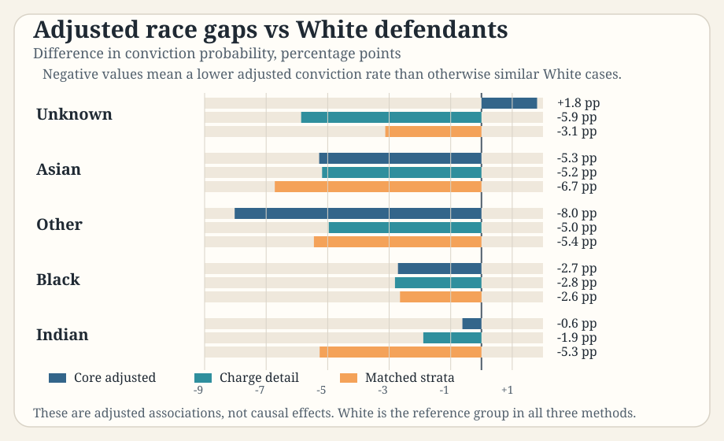

# Race and Conviction Likelihood: An Adjusted-Association Analysis

**If we compare cases that look similar on other characteristics, does the defendant's race still correlate with whether the case ends in conviction?**

The short answer: yes. Across multiple approaches, non-White defendants have lower adjusted conviction rates than White defendants with otherwise similar case profiles. The differences are modest but consistent.

The figure above summarizes the main result: each bar shows the estimated difference in conviction rate relative to White defendants, after adjusting for other case characteristics. Negative values mean lower conviction rates.

---

## Background: why raw rates can be misleading

The raw conviction rates in this dataset vary widely by race:

| Race group | Raw conviction rate | Cases |
|---|---:|---:|
| White | 45.7% | 485,374 |
| Black | 33.7% | 564,258 |
| Asian | 25.1% | 46,882 |
| Indian | 32.5% | 4,719 |
| Other | 61.7% | 10,195 |
| Unknown | 59.8% | 497,824 |

But raw rates mix together many things. White defendants might be concentrated in counties with higher conviction rates, or charged more often with case types that tend to result in conviction. To understand whether race itself is associated with outcomes, you need to compare cases that are similar in other ways.

That is what an adjusted analysis does.

---

## What the adjusted analysis does

The analysis uses two complementary approaches.

### Approach 1: Logistic regression models

Logistic regression estimates the relationship between race and conviction while holding other variables constant. Two versions were run:

**Core-adjusted model.** Controls for county, court type, arrest type, charge severity, age group, ethnicity, gender, arraignment year, and arraignment month — the main case-level variables available in the public data.

**Charge-detail-adjusted model.** Adds the specific law section, charge weight, and attempt flag on top of all core controls. This tests whether the race association persists even among cases with the same specific charge.

### Approach 2: Matched-strata comparison

Instead of a model, this approach groups cases into narrow "strata" defined by the same combination of county, court type, arrest type, severity, age group, ethnicity, gender, arraignment timing, and charge weight. Within each stratum, cases share the same profile on all those variables. Conviction rates are then compared between race groups only within shared strata, weighted by stratum size.

This is a more direct, less model-dependent way of asking the same question.

---

## Results

All three approaches tell a similar story. When comparing cases with similar observable characteristics, non-White defendants have somewhat lower conviction rates than White defendants.

### Core-adjusted model results

After adjusting for the main case-level variables, the estimated differences in conviction probability relative to White defendants are:

| Race group | Difference vs. White (percentage points) |
|---|---:|
| Asian | −5.3 |
| Black | −2.7 |
| Indian | −0.6 |
| Other | −8.0 |
| Unknown | +1.8 |

For example, a case with a Black defendant is estimated to have a conviction probability about 2.7 percentage points lower than an otherwise identical case with a White defendant.

### Charge-detail-adjusted model results

Adding specific charge information does not eliminate the pattern:

| Race group | Difference vs. White (percentage points) |
|---|---:|
| Asian | −5.2 |
| Black | −2.8 |
| Indian | −1.9 |
| Other | −5.0 |
| Unknown | −5.9 |

The Black–White gap is essentially unchanged (−2.8 pp vs. −2.7 pp). The "Unknown" group, which had a slight positive difference in the core model, shifts to −5.9 pp once charge details are added — suggesting that the "Unknown" category had been absorbing some charge-mix differences in the simpler model.

### Matched-strata results

The matched-strata comparison, which uses no statistical model, produces similar findings:

| Race group | Difference vs. White (percentage points) |
|---|---:|
| Asian | −6.7 |
| Black | −2.6 |
| Indian | −5.3 |
| Other | −5.4 |
| Unknown | −3.1 |

The Black–White difference (−2.6 pp) is very close to what both regression models find. For Asian defendants, the strata-based estimate (−6.7 pp) is slightly larger than the regression estimates (−5.2 to −5.3 pp). The overall direction — non-White groups having lower adjusted conviction rates than White defendants — holds across all methods.

---

## What the analysis suggests

Three independent methods — a core regression, a charge-detail regression, and a model-free strata comparison — all point in the same direction:

- **Race is associated with conviction likelihood even after adjusting for other observable case characteristics.** The association is not an artifact of one particular model specification.
- **The direction is consistent:** non-White groups show lower adjusted conviction rates than White defendants with similar case profiles.
- **The Black–White gap is roughly 2.5 to 2.8 percentage points** across methods. The Asian–White gap is larger, roughly 5 to 7 percentage points.
- **The pattern is robust to adding charge-level detail.** Controlling for the specific law section and charge weight does not explain away the race association.

---

## Limitations

- **Unmeasured variables.** The public data lacks evidence strength, attorney quality, criminal-history detail, plea dynamics, and pretrial detention status. Any of these could partly or fully explain the adjusted gaps.
- **Large "Unknown" category.** About 31% of cases have race recorded as "Unknown," which may distort comparisons if recording practices vary by jurisdiction.
- **Observational design.** No adjustment fully substitutes for random assignment; unmeasured differences could widen or narrow the true gaps.
- **New York only, 2021–2025.** Results may not generalize to other states or time periods.

---

## Summary

Across 1.6 million New York arraignment records, race is associated with conviction likelihood even after adjusting for county, court type, charge severity, arrest type, age, gender, ethnicity, arraignment timing, and specific charge details. The adjusted differences are consistent across multiple methods: non-White defendants have lower conviction rates than White defendants with similar case profiles, with the Black–White gap at roughly 2.5 to 2.8 percentage points and the Asian–White gap at roughly 5 to 7 percentage points.
